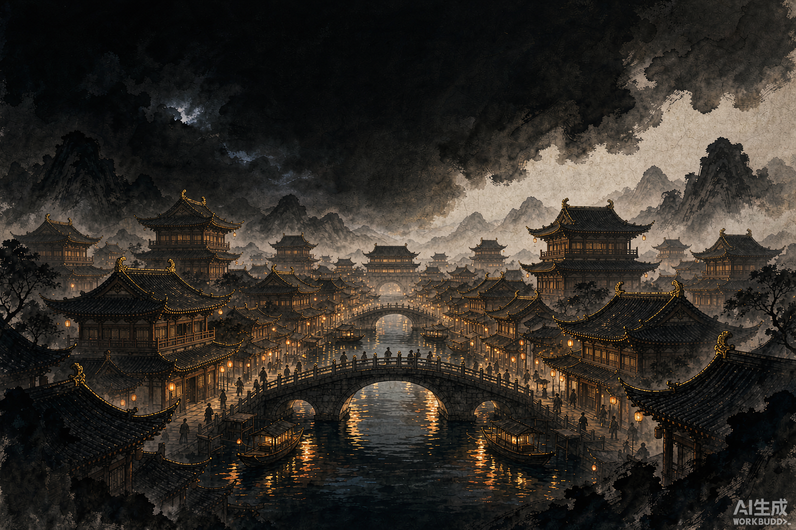

# 物料③　官方素材包 + AI 宣发主视觉

> 样例组：第 01 组 ｜ 产出场次：第 3 场 ｜ 命名：`01-逆水寒-03-官方素材包与主视觉`

## 一、官方素材包（5 张）

> 真实课堂中，这 5 张由素材统筹从游戏官网/官微下载后上传；示例包用 `03-主视觉海报.png` 演示 AI 基于素材生成的成品。

| 编号 | 素材 | 来源 | 用于 |
|---|---|---|---|
| A1 | 游戏主视觉海报（横版） | 官网首页 | 定调性、取色 |
| A2 | 角色立绘 · 男主 | 官网角色页 | 主视觉主体参考 |
| A3 | 角色立绘 · 女主 | 官网角色页 | 主视觉主体参考 |
| A4 | 场景图 · 汴京夜景 | 官网场景页 | 背景氛围参考 |
| A5 | 官网介绍 PDF | 官网下载页 | 世界观文案依据 |

## 二、素材如何进入工作流（连接器使用记录）

| 步骤 | 操作 | 观察 |
|---|---|---|
| 1 | 把 A1–A5 通过连接器导入 WorkBuddy | 素材在会话中持续在场，不必每次重传 |
| 2 | 让 AI 读 A5，总结 3 条世界观要点 | 输出基于官方文本，不是通用武侠套话 |
| 3 | 以 A2/A4 为参考生成主视觉 | 画面出现"宋韵建筑 + 水墨山形"，与仅文字描述相比明显更贴题 |
| 4 | 记录本次调用 Skill / 连接器 / 专家的名称 | 写入物料⑦ 项目复盘 |

## 三、AI 宣发主视觉

| 项 | 内容 |
|---|---|
| 生成方式 | 连接器导入官方素材 + 海报生成 Skill + 审美专家把关 |
| 画面要点 | 宋韵屋檐、水墨远山、宣纸纹理、鎏金点缀、留白构图 |
| 与风格基调板的对应 | 主色取自物料② 墨黑/鎏金/宣纸白；构图遵循"留白、克制" |
| 本组判断 | 比裸聊生成的"热血战斗图"更贴合逆水寒调性，但人物面部细节仍需人工修 |
